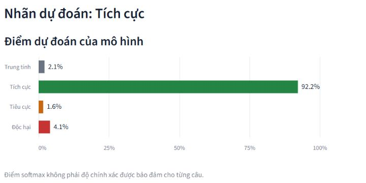

# Checklist demo NEU-ESC SimpleRNN

## Trạng thái đã kiểm tra

Ứng dụng thật nằm ở `F:\DPL project\Assignemtn 23.10\streamlit_demo`. Đã chạy lại suy luận CPU và Streamlit AppTest bằng model thật ngày **23/10/2026**, đối chiếu với predict.py trong artifact. Đã mở trình duyệt local, nhập câu A và nhìn thấy nhãn cùng bốn điểm. Sai lệch tối đa so với predict.py trên 8 câu kiểm tra là 0,0 trong môi trường này (ngưỡng rtol=1e-5, atol=1e-6). Không suy rộng thành benchmark hoặc bảo đảm cho máy khác.

Model, preprocessing.py, config.json và label_map.json trong app khớp byte với `run_20261023_065529_443169.zip`. SHA-256 của model:

`c4a9b1240c17c329269ec1a79ae84a53e8ac422b6e411240053b77f86d8e171a`

## Chuẩn bị trước buổi nói

- [ ] Nhân phụ trách mở slide, theo dõi đồng hồ và thao tác app; Khang nói trong 90 giây demo.
- [ ] Mở PPTX và kiểm tra font/dấu tiếng Việt trên máy chiếu. Có PDF dự phòng local.
- [ ] Chạy đúng Python của .venv, không dùng .venv-ui. Môi trường đã kiểm chứng: Python 3.13.5, TensorFlow 2.21.0, Keras 3.13.2, NumPy 2.1.3, Streamlit 1.66.1.
- [ ] Chạy app, bấm Phân tích ít nhất một lần **trước khi bắt đầu trình bày** để warm-up model/cache. Lần nạp đầu có thể mất vài giây.
- [ ] Dán thử A và B, xem đủ 4 thanh điểm, dùng kết quả live làm căn cứ. Không cần Colab, GPU hoặc internet sau khi đủ thư viện và artifact.
- [ ] Chuẩn bị câu C để sửa nếu còn thời gian. Đã biết C có thể dự đoán sai, không hứa phủ định chắc chắn làm đổi nhãn.
- [ ] Mở app trong trình duyệt riêng; tập Alt+Tab sang app và trở về slide 10.
- [ ] Giữ ảnh thật `assets/DEMO_KET_QUA_THAT.png` và ảnh trên slide 9 để dự phòng.

## Mở ứng dụng thật trên máy hiện tại

Cách nhanh: mở `F:\DPL project\Assignemtn 23.10\streamlit_demo\run_demo.cmd`. File này đã bật UTF-8. Hoặc chạy trong PowerShell:

```powershell
Set-Location -LiteralPath 'F:\DPL project\Assignemtn 23.10\streamlit_demo'
& '.\.venv\Scripts\python.exe' -B -X utf8 -m pip check
& '.\.venv\Scripts\python.exe' -B -X utf8 check_demo.py --require-model
& '.\.venv\Scripts\python.exe' -B -X utf8 -m streamlit run app.py --server.address 127.0.0.1
```

Mở **http://127.0.0.1:8501**. Nếu cổng 8501 đã có app đang hoạt động, dùng trang đó. Nếu có dịch vụ khác chiếm cổng, chạy app với `--server.port 8502` và mở cổng mới. Không dừng tiến trình không rõ nguồn. Nhập câu ở ô **Nhập bình luận** rồi bấm **Phân tích**. Chọn ví dụ có sẵn không thay thế bước bấm.

## Artifact phải đặt ở đâu?

Các file phải nằm trực tiếp trong `streamlit_demo/artifacts/`, không lồng thêm thư mục run.

```text
streamlit_demo/
  app.py
  inference.py
  artifacts/
    model.keras
    preprocessing.py
    label_map.json
    config.json
    environment.json
    requirements-inference.txt
    predict.py
    metrics.json
    confusion_matrix.png
    training_curves.png
```

Trên máy hiện tại đã có đủ artifact, không cần giải nén lại. Khi chuyển máy, lấy các file từ cùng ZIP chính thức vào thư mục mới trống, giữ nguyên tên và không trộn nhiều lần train. Không ghi đè một bộ artifact đang dùng mà chưa sao lưu. Dừng app do nhóm mở trước khi thay bộ artifact rồi khởi động lại để xóa cache.

Máy mới cần Python phù hợp với TensorFlow, sau đó cài trong môi trường riêng bằng `python -m pip install -r artifacts/requirements-inference.txt -r requirements.txt`. Các lệnh cài chỉ là hướng dẫn cho máy mới, chưa thực thi trong nhiệm vụ tạo slide. Kiểm tra pip check và check_demo.py --require-model trước buổi trình bày. Không tự đổi model hoặc train lại để chữa lỗi cài đặt.

## Ba câu tự tạo đã thử bằng model thật

**A:** Bài viết rất hữu ích, cảm ơn bạn đã chia sẻ!

**B:** Mình không hài lòng với cách xử lý này.

**C, tùy chọn sửa câu:** Bài viết không hữu ích, tôi rất thất vọng.

Các câu do người chuẩn bị tự tạo để demo, không phải một tập đánh giá. Tên “lời khen” hoặc “phàn nàn” chỉ là mô tả câu; bảng dưới là phản ứng của model, không phải nhãn chuẩn do dataset cung cấp.

| Câu | 0 Neutral | 1 Positive | 2 Negative | 3 Toxic | Nhãn model |
|---|---:|---:|---:|---:|---|
| A | 2,100% | 92,224% | 1,616% | 4,060% | Tích cực |
| B | 17,743% | 1,124% | 74,803% | 6,330% | Tiêu cực |
| C | 9,600% | 48,304% | 27,240% | 14,856% | Tích cực |

Các giá trị có thể lệch nhỏ giữa môi trường do số thực. Đọc kết quả hiện tại trên màn hình, không đọc thuộc một số nếu app đang hiển thị khác. Điểm softmax chưa được hiệu chuẩn và không phải độ chính xác của từng câu.

Câu C có sắc thái phàn nàn nhưng model vẫn chọn Tích cực trong lần thử. Cách nói: “Nhãn chưa đổi dù câu đã thay đổi. Đây là một ví dụ model còn hạn chế khi hiểu ngữ nghĩa và phủ định.” Không sửa hoặc giả kết quả để demo trông đúng hơn.

## Đúng 90 giây trên slide 9

| Thời gian trong demo | Nhân thao tác | Khang nói / quan sát |
|---|---|---|
| 00–15 giây | Alt+Tab sang app đã warm-up | Model đã lưu, chuẩn hóa chung, CPU, không train |
| 15–40 giây | Dán A, bấm Phân tích | Đọc nhãn và điểm cao nhất thật |
| 40–60 giây | Dán B, bấm Phân tích | Đọc nhãn và nhìn thay đổi bốn điểm |
| 60–70 giây | Nếu kịp, dán C và bấm | Quan sát phản ứng, thừa nhận nếu dự đoán sai |
| 70–90 giây | Quay về slide 10 trước 9:40 toàn buổi | Softmax, giới hạn, câu demo không là kết quả đánh giá |

Nếu chậm, bỏ C trước. Không mở phần đánh giá dài hoặc confusion matrix trong 90 giây vì slide 8 đã trình bày metric. Nếu Nhân không nói mở đầu vẫn giữ nguyên vai trò thao tác ở đây.

## Nếu app không chạy

- **Trong lúc chuẩn bị:** thiếu file thì kiểm tra đường dẫn artifacts; lỗi charmap thì dùng -X utf8/run_demo.cmd; lỗi thư viện thì kiểm tra môi trường và environment.json. Không train lại.
- **Trong lúc trình bày:** chỉ dành tối đa khoảng 10 giây thử lại. Nhân quay về slide 9. Khang nói: “Ứng dụng đang gặp lỗi trên máy trình bày. Đây là ảnh chụp từ lần suy luận thật đã thử trước, không phải kết quả live hiện tại.” Sau đó giải thích luồng và ảnh thật, kết thúc demo đúng 90 giây.
- Không thay ảnh chụp thật bằng kết quả dựng hoặc tự tạo xác suất. Nếu chưa có kết quả cho câu mới, nói chưa suy luận được.
- PDF chỉ để xem slide. PDF không chạy model hay chứa live demo.


